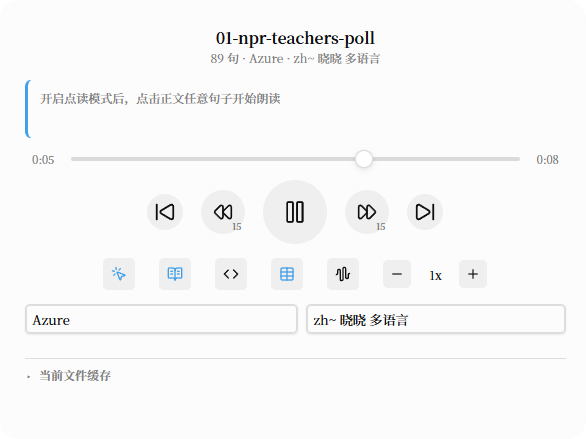

# Voice Aloud

> 逐句朗读 Obsidian 笔记的 TTS 插件。**点击正文任意句子，从该句开始整篇连读**，当前句高亮跟随，预取 + 哈希缓存让播放无缝衔接。桌面与移动端可用，支持锁屏续播。



*播放面板：文件名、句数与TTS服务/音色、进度条、传输控制、点读与内容开关、TTS服务与音色下拉，底部是可展开的「当前文件缓存」。*

## 功能

### 朗读体验

- **点读模式**：一个命令或按钮进入——自动切到阅读视图并启用「点击句子开始朗读」；切回编辑模式、关闭笔记或再次点击即退出，平时阅读视图零感知
- **播放面板**：播放/暂停/停止、上一句/下一句、回退 N 秒（可配置）、11 档倍速（0.75x–3x）、当前句展示（点击定位正文）、一键加入预生成队列
- **正文高亮跟随**：TTS 断句与正文标注共用同一套切分逻辑，点击、缓存失效、编辑后续播都精确对齐；同一句话在文中出现多次时按前后文定位，不会跳错
- **内容开关**：围栏代码块按行朗读、表格逐格朗读，两个图标按钮切换（默认关闭），也可绑定命令

### 缓存与预生成

- **句子级哈希缓存**（IndexedDB）：缓存键包含账号 / 供应商 / 模型 / 音色 / 语言 / 句子文本（Azure 另含区域与请求体版本）——改一句只重合成那一句；没有这些维度的供应商键值与旧版本一致，升级不会让既有缓存失效
- **按音色清理**：设置页可按笔记查看与清理；播放面板底部展开「当前文件缓存」后可勾选特定音色清理，换音色时保留其余音色的音频
- **预生成队列**：跨笔记后台批量合成——右键文件/文件夹或命令入队，独立队列页查看总进度与每篇进度，支持启停 / 暂停 / 取消 / 置顶 / 重试失败句。队列持久化，重启后自动继续；按账号设并发上限，本地 TTS 账号共享全局总并发；播放时队列「让路」（即时合成优先，命中缓存则零影响）

### 多供应商

供应商（系统适配器）与账号（你的实例配置）分离，可同时配置多个账号随时切换：

| 供应商           | 接口                                             | 说明                         |
| ------------- | ---------------------------------------------- | -------------------------- |
| OpenAI 兼容     | `POST /v1/audio/speech`                        | 支持自托管服务                    |
| Qwen3-TTS     | `/v1/audio/speech` + `/api/voices` + `/health` | 音色发现、健康检查、语言参数             |
| Azure TTS     | SSML + `voices/list`                           | 服务区域配置、中英混排语言域（多语言 / HD 音色）、三档输出码率、音色清单 |
| Xiaomi MiMo   | chat-completions 形态                            | 支持风格指令                     |
| 系统 Web Speech | —                                              | 内置离线保底，无需配置                |

## 安装

### 从 GitHub Releases

1. 从 [Releases](../../releases) 下载 `main.js`、`manifest.json`、`styles.css`
2. 放入 vault 的 `.obsidian/plugins/voice-aloud/` 目录
3. 重启 Obsidian，在「第三方插件」里启用 Voice Aloud

用 Azure 的话，再下载一份默认音色清单放进同一目录（可选）：

- **下载**：[`azure-voices.json`](./azure-voices.json) → 页面右上角 **Download raw file**；或直接点[直链下载](./azure-voices.json?raw=true)（浏览器里是纯文本，右键「另存为」即可）
- **放哪**：`.obsidian/plugins/voice-aloud/azure-voices.json`，与 `main.js` 同级，文件名不要改
- **不放也行**：下拉会显示账号下全部音色（900+ 个），挑起来很费劲；放上这份精选清单（26 条中英日韩音色）更好用
- 这个文件不会被升级覆盖，可以放心改（详见下方「升级时这个文件会怎样」）

### 通过 BRAT

把本仓库地址加入 [BRAT](https://github.com/TfTHacker/obsidian42-brat)，即可安装并跟踪后续版本。

## Azure 音色清单

一个 Azure 订阅常有 900+ 个音色、140+ 个 locale，全部塞进下拉框没法用。插件目录下的 `azure-voices.json` 决定播放面板显示哪些音色：

```json
{
  "voices": [
    { "id": "zh-CN-Xiaoxiao:DragonHDFlashLatestNeural", "name": "晓晓 最新神经语音" },
    { "id": "en-US-AndrewMultilingualNeural" }
  ]
}
```

- **数组顺序就是下拉顺序**；`id` 必须是 Azure 的 Voice ShortName
- `name` 可省略：中文音色建议写中文名，其他语言省略后按 ID 自动格式化（`en-US-AndrewMultilingualNeural` → `Andrew Multilingual Neural`）
- 显示时统一加语言前缀：`zh~ 晓晓 多语言`、`en~ Ana Neural`、`ja~ Aoi Neural`
- 也支持简写：`["zh-CN-XiaoxiaoNeural"]` 或 `{ "zh-CN-XiaoxiaoNeural": "晓晓" }`
- 改完执行命令「重新加载 Azure 音色清单」即可生效，无需重启
- 删掉该文件或把 `voices` 置空 → 回退为显示账号下全部音色

仓库内的 [`azure-voices.json`](./azure-voices.json) 是一份 26 条的中英日韩精选清单，可直接[下载](./azure-voices.json?raw=true)使用，也可下载后自己改。完整的四语种音色参考（含性别 / 地区 / 类型 / 状态）见 [`docs/azure-voices-4langs.md`](docs/azure-voices-4langs.md)。

> 中英混读（英文句里的 `50 percent` 读成 fifty 而不是「五十」）依赖 SSML 的 `<lang>` 语言域，
> 微软仅对**多语言音色**（名称含 `Multilingual`）与 **HD 音色**（`角色:基础模型` 冒号形式）支持该元素。
> 普通音色（如 `zh-CN-XiaoxiaoNeural`）保持不带标签的纯文本请求——需要混读时请从清单里选多语言 / HD 音色。
> 新建账号的默认音色因此是 `zh-CN-XiaoxiaoMultilingualNeural`（旧账号不受影响，仍用你自己选的音色）。

### 升级时这个文件会怎样

`azure-voices.json` 是**你的配置文件**，不是插件运行必需的文件：

- Obsidian 与 BRAT 升级插件时只写入 release 里的 `main.js`、`manifest.json`、`styles.css`，**不会覆盖也不会删除**插件目录里的其它文件——`azure-voices.json`、`data.json` 都原样保留
- `deploy.mjs` 同样跳过已存在的 `azure-voices.json`（只在你没有这个文件时才复制一份默认清单）
- 因此：**你改过的清单在升级后一定还在**；反过来，新版本仓库里的默认清单也**不会**自动替换掉你已有的文件

想换成新版本仓库里的默认清单：重新[下载一份](./azure-voices.json?raw=true)覆盖过去（覆盖前建议先备份你自己的）。删掉该文件则回退为「账号下全部音色」，不是回到默认清单。

## 开发

```bash
npm install
npm run dev        # watch 模式构建
npm run build      # 生产构建（minify）
npm run lint       # ESLint
npm run typecheck  # TypeScript 严格类型检查
npm test           # Vitest 单元测试（199 项）
npm run verify:release  # 发布就绪检查：manifest / versions / 构建产物 / release 资产（BRAT 与商店的硬性要求）
```

### 本地部署到 vault

仓库不保存任何本机路径，两种方式任选：

```bash
node deploy.mjs <vault>/.obsidian/plugins/voice-aloud
# 或
VOICE_ALOUD_PLUGIN_DIR=<vault>/.obsidian/plugins/voice-aloud node deploy.mjs
```

想省掉每次输路径，在本地建 `deploy.local.mjs`（已在 `.gitignore` 中）写死自己的目录，之后 `node deploy.local.mjs` 即可。脚本会先构建，再复制 `main.js` / `manifest.json` / `styles.css`；`data.json` 与已存在的 `azure-voices.json`（你的音色清单）不会被覆盖——想恢复默认清单，删掉该文件再部署一次。

### 架构

```
src/
├── main.ts              # 插件入口：命令、事件接线、队列持久化
├── i18n/                # 文案集中管理（中文，预留多语言）
├── core/
│   ├── sentences.ts     # 断句 + 句子身份（hash），TTS 与正文标注共用
│   ├── annotation.ts    # 阅读视图句子 span 标注 + 播放高亮
│   ├── point-read.ts    # 点读模式状态机
│   ├── player.ts        # 播放状态机（预取、回退 N 秒）
│   ├── synth-service.ts # 共享合成服务（缓存查询/合成/落缓存 + in-flight 去重）
│   ├── pregen-queue.ts  # 预生成队列（任务状态机 + 句子级并发调度 + 持久化）
│   ├── mediasession.ts  # 系统媒体键 / 锁屏控制
│   ├── accounts.ts      # 账号模型与当前账号解析
│   ├── voice-catalog.ts # Azure 音色清单解析与显示名格式化
│   ├── providers/       # TTS 供应商适配器（统一接口 + 注册表）
│   └── cache/           # IndexedDB 音频缓存 + 笔记反向索引
├── ui/                  # Player 面板、预生成队列视图、设置页、账号编辑弹窗
└── util/                # 哈希、字节格式化等工具
```

## English

Voice Aloud is a text-to-speech plugin that reads your Obsidian notes aloud sentence by sentence. Click any sentence in reading view to start continuous playback from that point; the current sentence stays highlighted and playback is gapless thanks to prefetching plus a per-sentence hash cache. Works on desktop and mobile, with lock-screen controls via Media Session.

- **Point-read mode** — one command toggles click-to-read in reading view; switch back to editing or close the note to exit instantly.
- **Player panel** — play/pause/stop, previous/next sentence, configurable seek-back, 11 speed steps (0.75x–3x), current-sentence display, one-click enqueue for pregeneration, and toggles for reading code blocks and tables.
- **Sentence-level cache** (IndexedDB) — keys cover account, provider, model, voice, language and text, so an edited sentence alone is re-synthesized. The player panel exposes a collapsible per-note cache view with per-voice checkboxes, so switching voices only discards the old voice's audio.
- **Pregeneration queue** — batch-synthesize notes in the background: enqueue via file/folder context menu or command, watch overall and per-note progress in a dedicated view, with start/pause/cancel/reorder/retry controls. The queue persists across restarts and resumes automatically; per-account concurrency caps plus a shared global cap for local-TTS accounts; playback always takes priority over queue work.
- **Multiple providers** — OpenAI-compatible endpoints (including self-hosted), a dedicated Qwen3-TTS adapter, Azure TTS (SSML with mixed-language `<lang>` spans for multilingual and HD voices, selectable output bitrate, editable voice catalog), Xiaomi MiMo TTS, and the built-in system voice as an offline fallback.

Install: download `main.js`, `manifest.json` and `styles.css` from [Releases](../../releases) into `.obsidian/plugins/voice-aloud/`, or add this repository to [BRAT](https://github.com/TfTHacker/obsidian42-brat).

## License

[MIT](./LICENSE)
